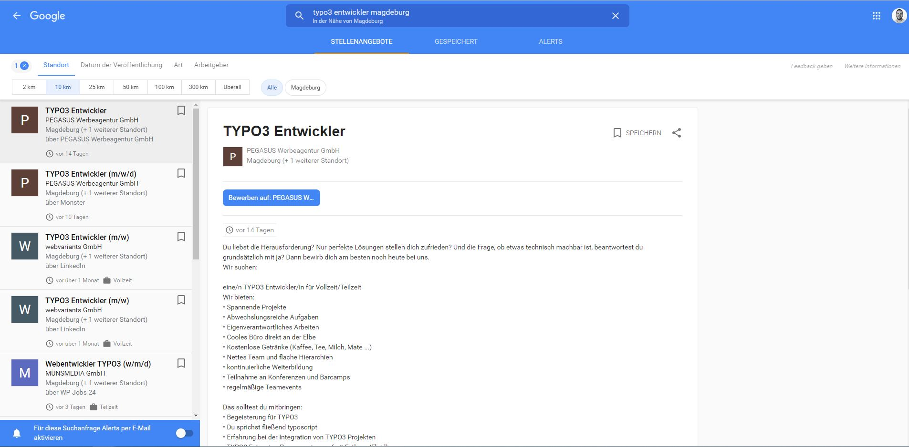

# TYPO3 Extension `google_for_jobs`



Job postings for TYPO3 with structured data for
[Google for Jobs](https://developers.google.com/search/docs/appearance/structured-data/job-posting).
The detail view adds a JSON-LD `JobPosting` to the page head, list views link to the
detail page. The Fluid templates only render the values without any styling, so they
can be adapted to every website.

## 1. Features

- Job and job location records with all required and recommended `JobPosting` properties
- List view with category filter and ordering, list of selected jobs, detail view
- Expired jobs (valid through date in the past) are hidden in lists
- Job title as page title of the detail page
- Field descriptions in the backend explain the Google requirements for each field
- Upgrade wizards for installations of version 1.x and 2.x

## 2. Installation

### Composer

```bash
composer require pegasus/google-for-jobs
```

### TYPO3 Extension Repository (TER)

Download and install the extension with the extension manager module.

## 3. Setup

1. Add the site set "Google for Jobs" to your site configuration, or include the static
   TypoScript "Google for Jobs" in your TypoScript record.
2. Create job location and job records in a folder.
3. Add the content element "Jobs (Google for Jobs)" to a page, choose the display
   (list, detail view or list of selected jobs) and select the folder as record storage page.
4. On the list page, select the detail page in the plugin settings.

### Mapping of fields to structured data

| Field | Property | Note |
| ----- | -------- | ---- |
| Title | `title` | required |
| Description | `description` | required, HTML |
| Date posted | `datePosted` | required |
| Organization name, website, logo | `hiringOrganization` | name required; links are output as absolute URLs |
| Job locations | `jobLocation` | required unless the job is fully remote |
| Valid through | `validThrough` | end of the selected day |
| Employment type | `employmentType` | |
| Reference number | `identifier` | falls back to the record uid |
| Fully remote, allowed countries | `jobLocationType`, `applicantLocationRequirements` | |
| Base salary | `baseSalary` | exact value or range, only if enabled |
| Direct application | `directApply` | only if specified |
| Education, experience | `educationRequirements`, `experienceRequirements`, `experienceInPlaceOfEducation` | beta properties at Google |

### TypoScript settings

```typoscript
plugin.tx_googleforjobs_job.settings.job {
    # Render the detail template; the structured data is always added
    renderDetailTemplate = 1
    # Hide jobs with a valid through date in the past in list views
    hideExpired = 1
    # Use the job title as page title of the detail page
    setPageTitle = 1
}
```

### Sitemap

```typoscript
plugin.tx_seo.config {
    xmlSitemap {
        sitemaps {
            jobs {
                provider = TYPO3\CMS\Seo\XmlSitemap\RecordsXmlSitemapDataProvider
                config {
                    table = tx_googleforjobs_domain_model_job
                    sortField = uid
                    lastModifiedField = tstamp
                    pid = <page id containing job records>
                    url {
                        pageId = <your detail page id>
                        fieldToParameterMap {
                            uid = tx_googleforjobs_job[job]
                        }
                        additionalGetParameters {
                            tx_googleforjobs_job.controller = Job
                            tx_googleforjobs_job.action = show
                        }
                    }
                }
            }
        }
    }
}
```

### Route enhancer

```yaml
routeEnhancers:
  JobsPlugin:
    type: Extbase
    extension: GoogleForJobs
    plugin: Job
    routes:
      -
        routePath: '/{job_title}'
        _controller: 'Job::show'
        _arguments:
          job_title: job
    defaultController: 'Job::show'
    aspects:
      job_title:
        type: PersistedAliasMapper
        tableName: tx_googleforjobs_domain_model_job
        routeFieldName: path_segment
```

## 4. Upgrade

### From 2.x to 3.x

1. Update the extension (Composer or TER) together with TYPO3 13.4 or 14.3.
2. Open *Admin Tools > Maintenance > Analyze Database Structure* and apply the
   suggested **additions** only.
3. Open *Admin Tools > Upgrade > Upgrade Wizard* and run
   "Google for Jobs: Migrate plugin to content element". Plugin settings and
   backend group permissions are carried over.
4. Compare custom Fluid templates with the new templates of the extension.
5. Remove unused database columns only after all upgrade wizards have been executed.

Existing job records, locations, relations, categories and files are kept unchanged.
Route enhancers and sitemap configurations keep working. See the
[changelog](CHANGELOG.md) for all breaking changes.

### From 1.x

Follow the steps above. The upgrade wizard "Google for Jobs: Migrate job locations of
version 1.x" moves the address data of the job records into job location records.
Run it **before** removing unused database columns.

## 5. Administration

### Versions and support

| google_for_jobs | TYPO3 | PHP | Support |
| --------------- | ----- | --- | ------- |
| 3.x | 13.4, 14.3 | 8.2 – 8.5 | Features, bugfixes, security updates |
| 2.x | 10.4, 11.5 | 7.2 – 8.1 | None (branch `11.5`) |
| 1.x | 9.5 | 7.0 – 7.2 | None |

### Development

```bash
composer install
composer ci:cgl
composer ci:phpstan
composer ci:tests:unit
typo3DatabaseDriver=pdo_sqlite composer ci:tests:functional
```

### Contribution

Pull requests are welcome. Please open an issue first and reference it in the pull
request, so the problem and its solution can be understood. Bugfixes should explain
how to reproduce the issue, ideally with a test.

### Changelog

Read the full changelog [here](CHANGELOG.md).
